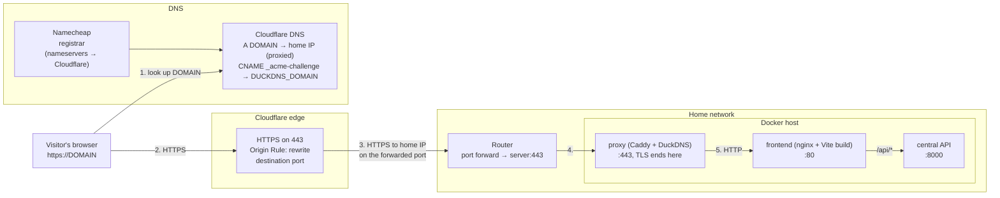
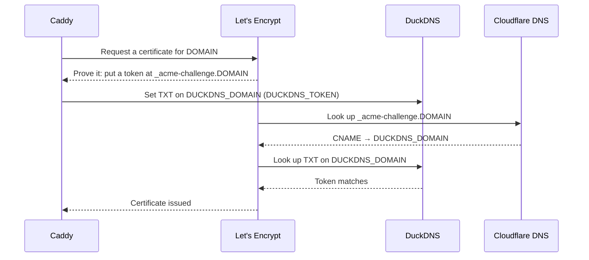

# HTTPS proxy

This folder builds the container that receives all public traffic for TickerLens.
It is [Caddy](https://caddyserver.com) with the [DuckDNS plugin](https://github.com/caddy-dns/duckdns) added. Caddy does two jobs:

1. **It ends HTTPS.** It holds a real Let's Encrypt certificate for `DOMAIN`
   and renews it on its own.
2. **It forwards each request** to the frontend container (nginx serving the
   Vite build), which in turn forwards `/api/` to the central API.

It is the only container published to the network (port `443`). Every other
service is reachable only on the Docker network or on `127.0.0.1`.

## Why it is needed

- **Browsers need HTTPS.** Signing in, the clipboard, and streamed AI answers
  all need a secure origin, and Cloudflare connects to the server over HTTPS.
- **The ISP blocks ports 80 and 443.** Let's Encrypt usually checks that you
  own a domain by calling it on port 80 or 443, which is impossible here.
  Caddy instead proves ownership with a DNS record (the DNS-01 challenge), so no
  inbound port is needed to get a certificate.
- **The DNS-01 record goes through DuckDNS.** The domain's
  `_acme-challenge` record is a CNAME to a free DuckDNS name. Caddy writes the
  challenge TXT record there with the DuckDNS token, so it never needs
  Cloudflare or Namecheap credentials.
- **The browser talks to one origin.** Caddy sends everything to the frontend,
  and nginx routes `/api/` to the central API, so there are no CORS settings.

## How a request flows



1. The domain is registered at **Namecheap**, whose nameservers point at
   **Cloudflare**, so Cloudflare answers all DNS for `DOMAIN`.
2. The browser connects to Cloudflare's edge on the normal HTTPS port.
3. A Cloudflare **Origin Rule** changes the destination port, so Cloudflare
   reaches the home IP on the port the router forwards (needed because the ISP
   blocks the standard ports).
4. The **router** forwards that port to port `443` on the machine running
   Docker.
5. **Caddy** ends TLS and passes the request to the frontend's nginx, which
   serves the app or forwards `/api/` to the central API.

## How the certificate is issued



The certificate is kept in the `caddy_data` volume, so rebuilding the container
does not request a new one (Let's Encrypt limits how often you can).

## Setup

### 1. DuckDNS

Create a free subdomain at [duckdns.org](https://www.duckdns.org) and copy its
token. Its IP does not matter; it is only used for the challenge record.

### 2. Namecheap

Under **Domain → Nameservers**, choose **Custom DNS** and enter the two
Cloudflare nameservers Cloudflare gives you when you add the site.

### 3. Cloudflare

| Setting | Value |
| --- | --- |
| DNS `A` record | `DOMAIN` → your home public IP, **Proxied** (orange cloud) |
| DNS `CNAME` record | `_acme-challenge` → `DUCKDNS_DOMAIN`, **DNS only** |
| Rules → Origin Rules | Hostname equals `DOMAIN` → **Destination port** = the router's public port |
| SSL/TLS → Overview | **Full (strict)**, since Caddy has a valid certificate |
| SSL/TLS → Edge Certificates | **Always Use HTTPS** on, so an `http://` visit is redirected before anything (such as a ChatGPT token) is sent |

Visitors always use `https://DOMAIN` with no port: browsers only reach
Cloudflare on its standard ports, and the Origin Rule is what moves the request
to the router's public port. A `.dev` domain is also on browsers' HSTS preload
list, so browsers never try plain HTTP for it.

### 4. Router

Forward the public port chosen above (TCP) to port `443` on the Docker host's
local IP. If your ISP allows it, that public port can be `443` itself and the
Origin Rule is not needed.

### 5. `.env`

```env
DOMAIN=example.dev
DUCKDNS_DOMAIN=example.duckdns.org
DUCKDNS_TOKEN=your-duckdns-token
```

Then start everything from the repo root:

```bash
docker compose up -d --build
```

Watch the certificate being issued with `docker logs -f proxy-container`.

## Files

| File | Purpose |
| --- | --- |
| [`Dockerfile`](Dockerfile) | Builds Caddy with the DuckDNS DNS plugin using `xcaddy`. |
| [`../Caddyfile`](../Caddyfile) | Site address, DNS-01 settings, and the `reverse_proxy` to `frontend:80`. Trusts Cloudflare's IP ranges, reads the visitor's address from `CF-Connecting-IP` and passes it on as `X-Real-IP`. Streaming is kept on (`flush_interval -1`) for AI answers. |
| [`../docker-compose.yml`](../docker-compose.yml) | Publishes `443`, mounts the Caddyfile, and keeps certificates in `caddy_data`. |
| [`../frontend/nginx.conf`](../frontend/nginx.conf) | Takes the visitor's address from Caddy's `X-Real-IP` (for the per-client relay limit) and keeps redirects relative so they stay on the public port. |

## Troubleshooting

- **No certificate / DNS errors in the logs:** check that the
  `_acme-challenge` CNAME exists and is *DNS only*, and that `DUCKDNS_TOKEN` is
  correct. Caddy checks the record through `1.1.1.1` and `8.8.8.8`.
- **Cloudflare error 521/522:** Cloudflare cannot reach the server. Check the
  Origin Rule port, the router forward, and that `proxy-container` is running.
- **Cloudflare error 525/526:** the TLS handshake with Caddy failed. Make sure
  the certificate was issued and SSL mode is Full (strict).
- **HTTP/3 is off** on purpose: only TCP 443 is published.
